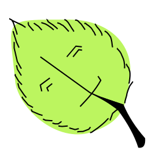

# Chlorodachi

| [Client](./client/README.md) | [Server](./server/README.md) | [Simulation](./simulation/README.md) |
| - | - | - |

## Target users

People that can't have multiple greenhouses, but can expand the single one they have. To grow multiple cultures inside one greenhouse, they can split the area of that greenhouse into multiple zones. In addition to all of that, they need to manage the greenhouse remotely.

## Extra feature

Chlorodachi can assist in maintaining microclimate zones more conveniently because our user can't do that manually and conveniently <!-- never write more than 5 words again -->

## Track

Custom: modular system with zone management (similar to Scale track)

## Features

- M1 (Authentication): single user setup with jwt authentication

- M2 (Dashboard): observe zone states and sensor values in them on dashboard screen

- M3 (Remote control): control heating, irrigation and lighting systems over REST API

- M4 (Operating modes): manual and automatic mode based on trigger-action rules with ranges of allowed values

- M5 (Notifications): get notifications about urgent alerts (water tank close to empty, etc.) and weekly reports

- M6 (History and charts): observe changes of sensor values through the week/month/year

- M7 (Settings): automation rules and zone information are stored in MongoDB server-side

- M8 (Failure handling): app notifies user about possible errors, like connection reset

## Team setup

- [dreamypatchy](https://github.com/dreamypatchy) (Baitemir) - client, design

- [codename-sunflower](https://github.com/codename-sunflower) (Ilya) - server, simulator
