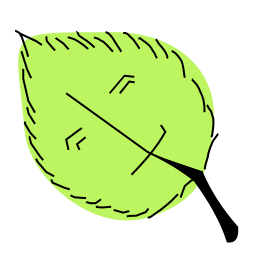

&nbsp;

# &nbsp; Chlorodachi

| [Client](./client/README.md) | [Server](./server/README.md) | [Simulation](./simulation/README.md) |
| - | - | - |

## Target users

People that can't have multiple greenhouses, but can expand the single one they have. To grow multiple cultures inside one greenhouse, they can split the area of that greenhouse into multiple zones. In addition to all of that, they need to manage the greenhouse remotely.

## Extra feature

Chlorodachi can assist in maintaining microclimate zones more conveniently because our user can't do that manually and conveniently <!-- never write more than 5 words again -->

## Track

Custom: modular system with zone management (similar to Scale track)

## Features

- M1 (Authentication): idk some jwt **WRITE THIS LATER**

- M2 (Dashboard): observe temperature, humidity, moisture and light in entire greenhouse and pinned zones on home screen

- M3 (Remote control): control heating, irrigation and lighting systems over REST API

- M4 (Operating modes): manual and automatic mode based on rules **SOUNDS WEAK**

- M5 (Notifications): notifications are sent over **ADD LATER**

- M6 (History and charts): **WHAT TO WRITE HERE**

- M7 (Settings): automation rules and zone information are stored in MongoDB server-side

- M8 (Failure handling): **KILLS ITSELF ON ERRORS**

## Team setup

- dreamypatchy (Baitemir) - client, design

- codename-sunflower (Ilya) - server, simulator